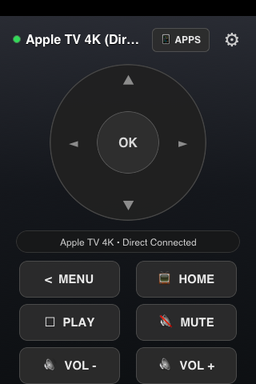
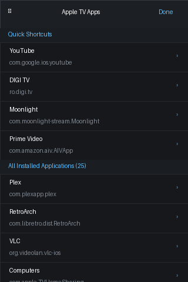

# LegacyAppleTVRemote (PodRemote)

[](https://github.com/solvedro/LegacyAppleTVRemote)
[](https://github.com/solvedro/LegacyAppleTVRemote)
[](https://github.com/solvedro/LegacyAppleTVRemote)
[](https://github.com/solvedro/LegacyAppleTVRemote)
[](LICENSE)

A standalone native Apple TV 4K & Apple TV HD remote control application designed for legacy iOS devices (**iPod touch 3rd/4th gen, iPhone 3GS/4/4S, iPad 1/2** running **iOS 5.0 through 6.1.6**).

Turn your classic iPod touch into a dedicated, premium living-room remote control for modern Apple TV. **No computer or bridge required during normal operation**—the iPod speaks the modern Apple Companion protocol directly to the Apple TV over your local Wi-Fi.

---

## ✨ Features

- **Standalone Direct Connection:** Connects directly over TCP to Apple TV Companion port `50590`. Once paired, no PC, server, or bridge is needed.
- **D-Pad & Gesture Trackpad:**
  - Center **OK / Select** button with tactile click.
  - Quadrant directional arrows (**Up, Down, Left, Right**) with visual flash indicators.
  - Directional swipe gestures on the circular trackpad ring.
- **Physical Remote Controls:**
  - **Menu / Back**, **Home / TV**, **Play / Pause**, **Mute**, and **Volume Up / Down**.
- **Installed App Launcher & Shortcuts (`📱 APPS`):**
  - Queries your Apple TV live for all installed applications (`FetchLaunchableApplicationsEvent`).
  - Dedicated **App Launcher** sheet displaying all installed apps with custom crisp app icon thumbnails (YouTube, Netflix, DIGI TV, Prime Video, Plex, Moonlight, RetroArch, VLC, etc.).
  - One-tap direct app launching on your Apple TV (`_launchApp`).
- **Now Playing Marquee & Artwork Thumbnails:**
  - Real-time media info tracking (`_iMC` / `_npI`) displayed on the sleek marquee bar with live thumbnail icon.
  - Asynchronous dynamic album art / poster thumbnail lookup and caching via iTunes Search API.
  - Interactive Now Playing card: tap the marquee to pop up full-resolution cover art with track and artist details.
- **Embedded Modern Cryptography:**
  - Pure-C implementation of RFC 8439 **ChaCha20-Poly1305 AEAD**.
  - **TweetNaCl** Curve25519 ECDH key exchange and Ed25519 signature verification.
  - **HKDF-SHA512** session key derivation.
  - Custom binary **OPACK** serializer/deserializer with object reference table support.
- **Bridge Relay Fallback:**
  - Includes a Python Companion bridge tool (`Tools/atv_bridge.py`) for initial PIN pairing and testing.

---

## 🏛 Architecture

```
┌─────────────────────────────────┐
│     iPod touch 3 / iPhone 4     │
│          (iOS 5.1.1)            │
│  ┌───────────────────────────┐  │
│  │   LegacyAppleTVRemote     │  │
│  │  ┌─────────────────────┐  │  │
│  │  │ TweetNaCl + RFC8439 │  │  │
│  │  │   ChaCha20-Poly1305 │  │  │
│  │  │   + OPACK Engine    │  │  │
│  │  └──────────┬──────────┘  │  │
│  └─────────────┼─────────────┘  │
└────────────────┼────────────────┘
                 │ TCP Direct (Port 50590)
                 │ Encrypted Companion Link
                 ▼
┌─────────────────────────────────┐
│          Apple TV 4K            │
│       (tvOS 13 - 18.x+)         │
│   ┌─────────────────────────┐   │
│   │        tvremoted        │   │
│   └─────────────────────────┘   │
└─────────────────────────────────┘
```

---

## 📱 Screenshots

| Remote Main Interface | App Launcher (`APPS`) |
| :---: | :---: |
|  |  |

---

## 📥 Installation & Prerequisites

Ready-to-install packages are available on the [Releases](https://github.com/solvedro/LegacyAppleTVRemote/releases) page or directly in the [`dist/`](dist/) folder:
- [**`AppleTVRemote.ipa`**](dist/AppleTVRemote.ipa) — Standard application bundle.
- [**`ro.solved.appletvremote_*.deb`**](dist/ro.solved.appletvremote_1.0.0-1+debug_iphoneos-arm.deb) — Cydia / Debian package.

### 1. Device & Firmware Prerequisites
- **Supported Devices:** iPod touch (3rd & 4th gen), iPhone (3GS, 4, 4S), iPad (1st, 2nd gen).
- **Supported Firmware:** iOS 5.0 through iOS 6.1.6.

### 2. Jailbreak & Tweak Requirements
Why is a jailbreak required?
> Modern Apple developer certificates and sideloading tools no longer support iOS 5 / 6 legacy code signature validation. A jailbroken device allows running unsigned legacy binaries without expiration or revocation.

- **Jailbreak:** Device must be jailbroken (e.g., using *Absinthe 2.0*, *redsn0w*, or *p0sixspwn* depending on device and iOS version).
- **AppSync Unified:** Required to install and run the `.ipa` without signature checks.
  - In Cydia, add repo: `https://cydia.akemi.ai/`
  - Install **AppSync Unified**.
- **Apple File Conduit "2" (AFC2)** *(Optional)*: Recommended for direct USB file transfers via 3uTools, iFunBox, or `ifuse`.

### 3. How to Install the Release

#### Option A: Installing the `.ipa` (Recommended)
1. Ensure **AppSync Unified** is installed on your jailbroken iPod/iPhone.
2. Download `AppleTVRemote.ipa` from [Releases](https://github.com/solvedro/LegacyAppleTVRemote/releases).
3. Install using your preferred tool:
   - **3uTools / iFunBox / legacy iTunes (12.6.5)**: Drag and drop the `.ipa` onto your device's Apps list.
   - **Sideloadly**: Select the `.ipa` and install to your connected device.
   - **Command Line (`ideviceinstaller`)**:
     ```bash
     ideviceinstaller install AppleTVRemote.ipa
     ```

#### Option B: Installing the `.deb` via Cydia / Terminal
1. Download `ro.solved.appletvremote_*.deb` from [Releases](https://github.com/solvedro/LegacyAppleTVRemote/releases).
2. Copy the `.deb` to your device (via AFC2, OpenSSH, or AirDrop/Safari).
3. Open the `.deb` in **iFile** or **Filza** and select **Installer**, or install via SSH:
   ```bash
   dpkg -i ro.solved.appletvremote_*.deb
   uicache
   ```
4. ATV Remote will appear on your Home Screen.

### 4. Network Prerequisites
- Both your iPod touch and modern Apple TV must be connected to the **same Wi-Fi network (LAN)**.
- Ensure Client/AP isolation is disabled on your Wi-Fi router.

---

## 🚀 Pairing & Getting Started

Initial pairing is handled seamlessly right from the iPod touch with a single background helper on your PC to negotiate the initial SRP exchange.

### Step 1: Start the Background Pairing Helper on your PC
Ensure Python 3.9+ is installed, then run:
```bash
pip install pyatv aiohttp
python Tools/atv_bridge.py
```

### Step 2: Pair Directly on your iPod touch
1. Open **ATV Remote** on your iPod touch.
2. Tap the **Settings (⚙)** button in the top right.
3. Tap **"Pair"**.
4. The 4-digit PIN will appear on your Apple TV screen.
5. An alert prompt will appear directly on your iPod touch: enter the 4-digit PIN and tap **Submit**.

**That's it!** The iPod touch automatically receives the cryptographic session credentials, saves them permanently, and establishes the encrypted direct connection.

The status LED will turn **Green** (`Connected (Direct Remote)`). **You can now shut down your PC**—the iPod communicates directly with the Apple TV forever.

---

## 🛠 Building from Source

This project is built using [Theos](https://theos.dev/) targeting `armv7` on `iphone:clang:6.1:5.0`.

### Prerequisites
- WSL Ubuntu / Linux or macOS with Theos installed.
- iOS 5.0+ SDK (e.g. `iPhoneOS6.1.sdk`).

### Build Command
```bash
make clean
make package
```
The compiled `.ipa` will be generated in `packages/AppleTVRemote.ipa`.

### Installing to Jailbroken Device
Deploy via AFC or AFC2 using `ideviceinstaller` or chunked AFC script:
```bash
ideviceinstaller -i packages/AppleTVRemote.ipa
```

---

## 📁 Project Structure

```
LegacyAppleTVRemote/
├── Classes/
│   ├── ATRAppDelegate.h/.m        # Application life cycle & window management
│   ├── ATRRemoteViewController.h/.m # D-Pad, trackpad, buttons & marquee UI
│   ├── ATRAppsViewController.h/.m   # Apple TV installed apps drawer & launcher
│   ├── ATRSettingsViewController.h/.m # Pairing & configuration UI
│   ├── ATRClient.h/.m            # Bridge relay client fallback
│   ├── Companion/
│   │   ├── ATRCompanionClient.h/.m # Native Companion TCP client & handshake
│   │   └── ATROpack.h/.m         # Binary OPACK encoder & decoder
│   └── Crypto/
│       ├── atr_chacha20_poly1305.c/.h # RFC 8439 ChaCha20-Poly1305 AEAD + HKDF
│       └── tweetnacl.c/.h        # TweetNaCl Ed25519 & Curve25519
├── Resources/
│   ├── Info.plist                # App bundle properties
│   └── Icon*.png                 # Retina & standard application icons
├── Tools/
│   └── atv_bridge.py             # Python pairing & HTTP bridge helper
├── Makefile                      # Theos compilation rules
├── README.md
└── .gitignore
```

---

## 💡 Technical Breakthroughs in this Project

1. **RFC 8439 ChaCha20-Poly1305 on armv7:** tvOS uses a 12-byte rolling nonce with little-endian 64-bit packet counter at index 0 and 4 trailing zero bytes. Fully implemented with zero external OpenSSL/cryptography dependencies.
2. **Deterministic Ed25519 Seed Keypair:** TweetNaCl was extended with `crypto_sign_seed_keypair` to properly derive 64-byte Ed25519 keys from 32-byte stored pairing seeds without overwriting private keys.
3. **Outer TLV Encrypted Payload Wrapping:** tvOS `PV_Next` (SeqNo 3) requires wrapping the encrypted payload within an outer TLV packet (`Tag 0x06` + `Tag 0x05`).
4. **Session Registration Handshake:** Direct HID keystrokes are ignored by tvOS `tvremoted` until the client negotiates `_systemInfo`, registers `_sessionStart` for `com.apple.tvremoteservices`, and opens a `TVRCSessionStart` protocol version `1.2` channel.

---

## 📜 License

MIT License. Feel free to use, modify, and distribute.

Credits to [pyatv](https://github.com/postlund/pyatv) for protocol research and reference implementations.
